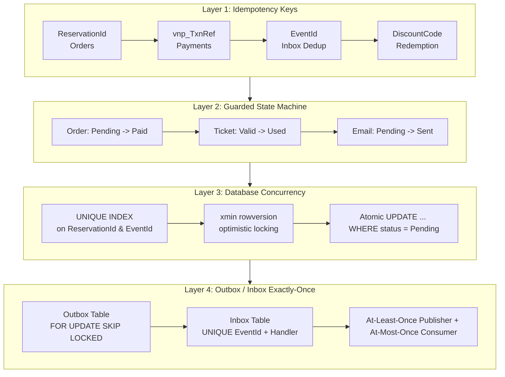
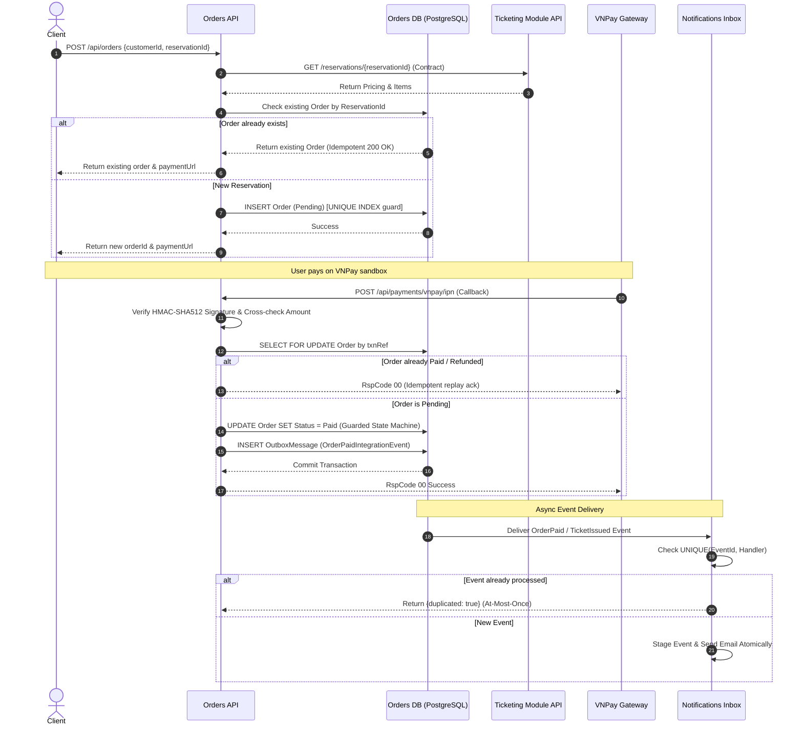
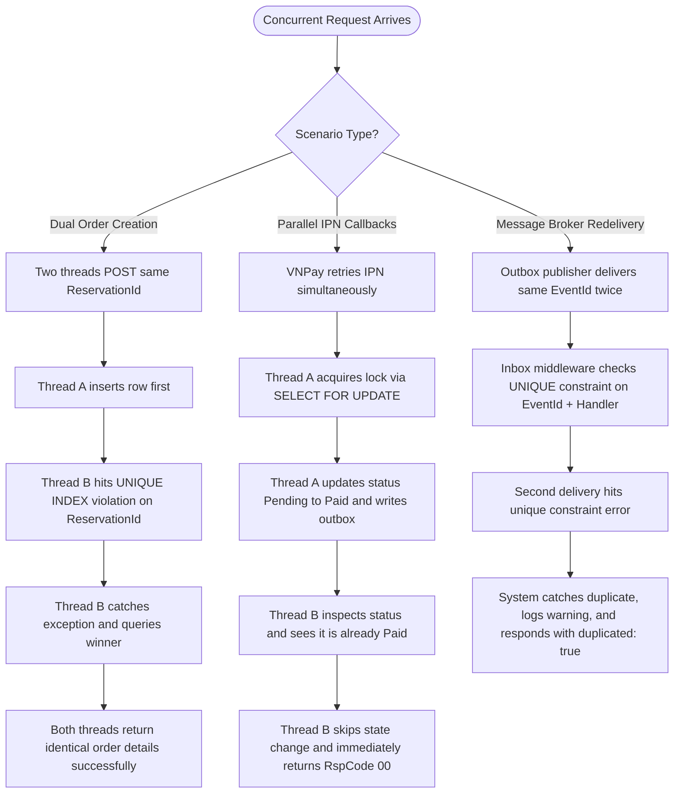

# Idempotency Architecture & Core Flows — Event Ticketing System (TV2 Orders & Notifications)

## 1. System Idempotency 4-Layer Protection Architecture

## 2. Order Creation & VNPay IPN Processing Flow

## 3. Race Condition Scenarios & Resolution Tree

